# github-profile-builder

A Claude skill that designs, builds and publishes a GitHub profile README. Every
person gets a banner designed around their own interests, and every widget is
checked before it goes live.

<p align="center">
  <br>
  <br>
  
</p>

<p align="center"><sub>Three example banners built with the kit: one real (my own profile) and two for made-up people. The skill designs a new one for each person.</sub></p>

## What it does

Ask Claude for a GitHub profile ("make my GitHub profile stand out", "redo my profile README"). With this skill it:

1. **Gathers facts.** It reads your public repos and their READMEs, and asks what you want to be known for and what to leave out. It never invents your stack or experience.
2. **Designs from top profiles.** It picks a few proven patterns (header banner, code-style "about me", project cards, quest log) and themes them around you.
3. **Builds a banner just for you.** It writes a short brief (who you are, what you care about, one visual metaphor, a layout, what moves) and draws a new animated pixel-art scene from it. The SVG is fully self-contained, so it works inside GitHub's image sandbox.
4. **Verifies everything.** It renders the banner in Chrome the way GitHub shows it, on dark and light themes. It checks every badge and icon (some popular ones silently render blank) and renders the Markdown with GitHub's own API.
5. **Publishes, if you say yes.** It creates `<you>/<you>`, uploads the files, hash-checks each commit, and confirms the live page.
6. **Optional contribution game.** A daily GitHub Action turns your contribution graph into a space shooter GIF. It runs the third-party code with a read-only token and pins every action to a commit SHA.
7. **Optional recent activity.** A weekly Action reads your 5 most recently active public repos and updates a "what I'm working on" table on your profile. Commit messages are treated as untrusted input, so a merged PR can't inject links or HTML into your profile.

## Example

A brief the skill wrote before drawing the trail banner:

```
Person:    data engineer (Python, Airflow, SQL, dbt)
Feel:      hiking in the Highlands, her two cats, film photography
Metaphor:  a mountain ridge at dusk, seen through a film camera's viewfinder, a cat walking the ridge
Layout:    centered text over a full-width landscape, with a viewfinder overlay
Motion:    cat walking (2-frame legs), clouds drifting, first stars, typing line
```

Run any example theme yourself:

```
python3 scripts/themes/trail.py examples/trail.json banner.svg
python3 scripts/render_check.py banner.svg shots --times 1,4,9
```

## What's inside

```
SKILL.md                    the workflow Claude follows
scripts/banner_kit.py       pixel font, typing animation, sprites, stars, CSS motion, SVG assembly
scripts/themes/             three example scenes (space, terminal, trail)
scripts/render_check.py     screenshots a banner like GitHub renders it
scripts/github_analyser.py  weekly recent-activity section from your last 5 active repos
assets/space-shooter.yml    secure contribution-game workflow
assets/analyser.yml         workflow for the analyser
tests/                      offline analyser tests (real and hostile fixtures)
assets/README-template.md   example section structure
references/                 banner design guide, top-profile patterns, verified widget facts,
                            workflow security notes, browser publishing playbook
examples/                   configs and rendered previews
```

## Install

**Claude apps (web, desktop, mobile):** download [`github-profile-builder.zip`](dist/github-profile-builder.zip), upload it as a custom skill, then enable it in Customize > Skills. Code execution needs to be turned on. See [Use custom skills](https://support.claude.com/en/articles/12512198-use-custom-skills).

**Claude Code:** clone the repo into your skills folder:

```
git clone https://github.com/kremendev/github-profile-builder ~/.claude/skills/github-profile-builder
```

Run `git pull` in that folder to update. See [Skills in Claude Code](https://code.claude.com/docs/en/skills).

The banner scripts need Python 3. `render_check.py` also needs Playwright and a Chromium or Chrome.

## Feedback

Got a banner that looks like an example with a new name, a widget that broke, or a publishing step that failed? Open an issue with what you asked for and what came out.

## License

MIT. See [LICENSE](LICENSE).
